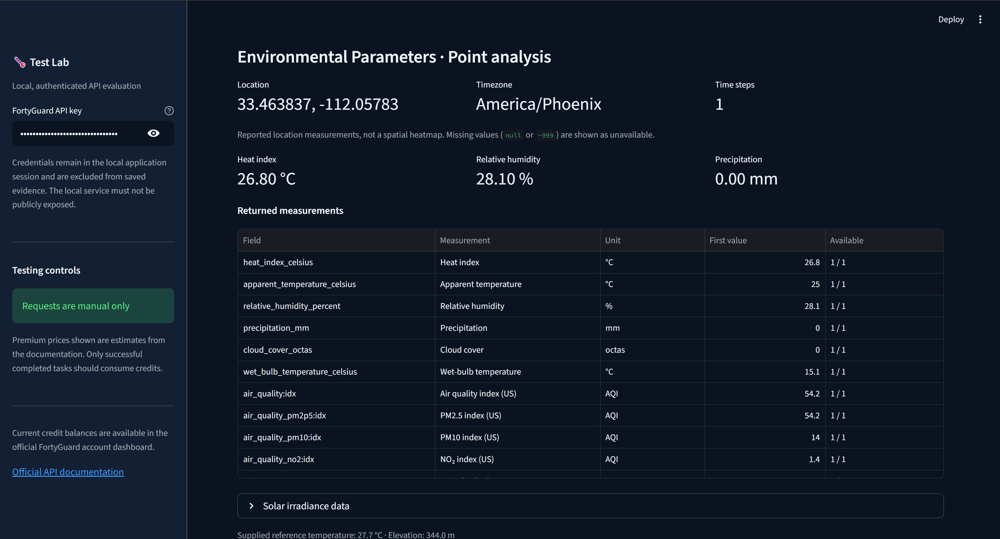
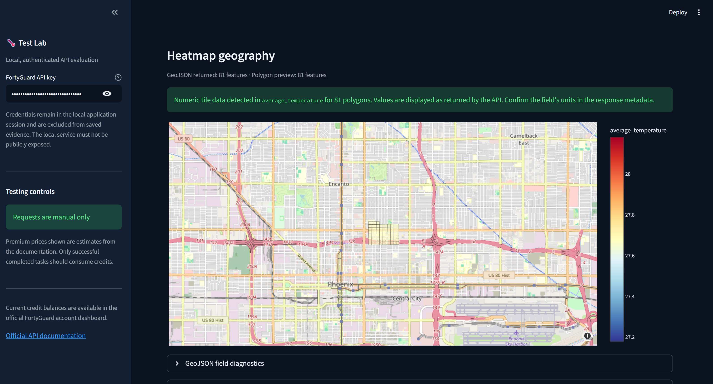
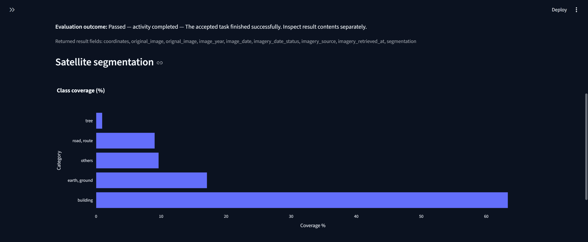
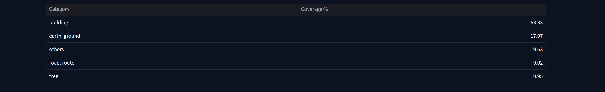
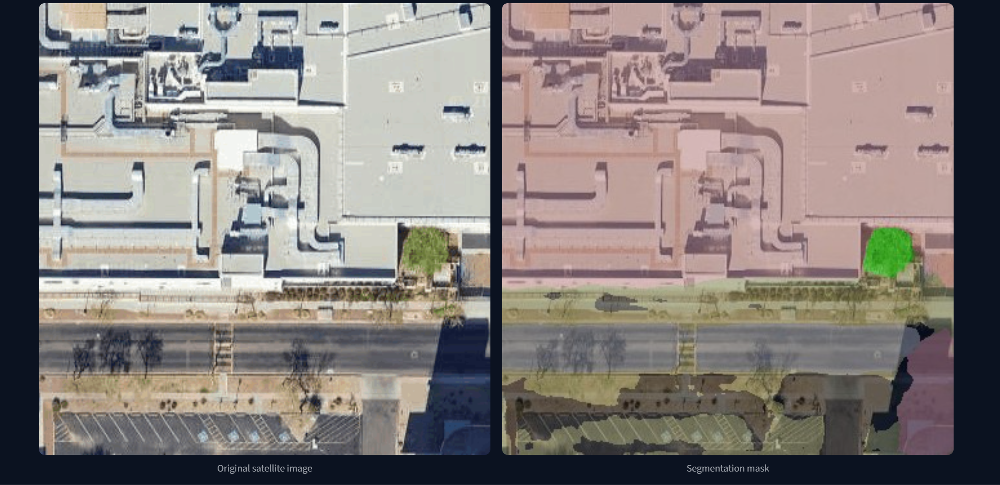
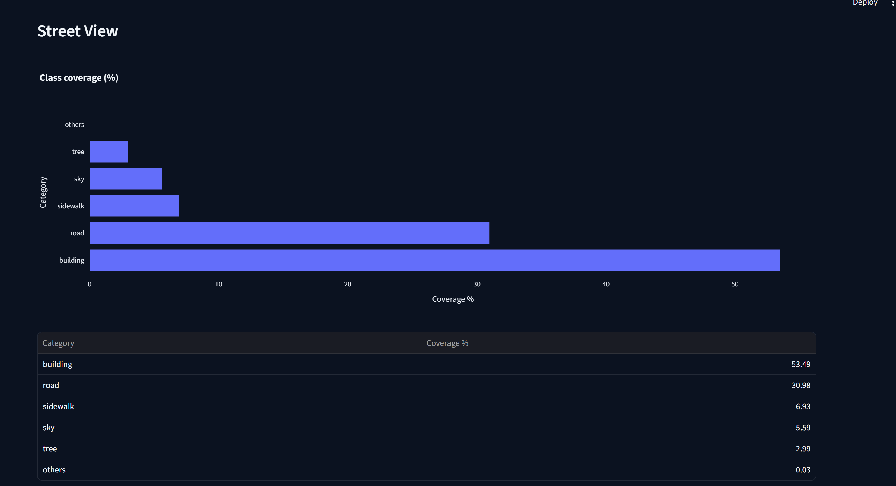
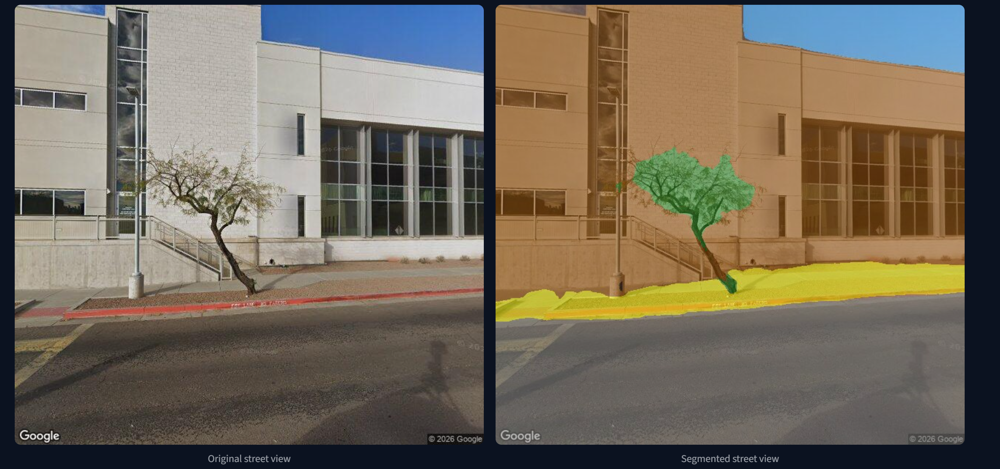
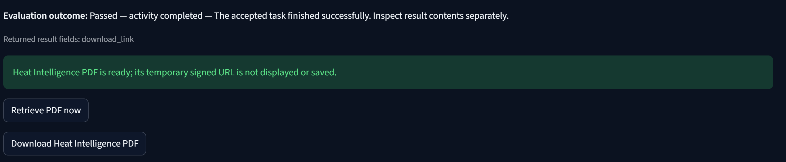

# FortyGuard | API Test Lab

### Interactive API Testing, Data Visualization & Technical Evaluation

A Python-based API testing and visualization workspace developed to evaluate the **FortyGuard Enterprise API** through structured test execution, response validation, interactive visualizations, and reproducible evidence collection.

Built using **Python and Streamlit**, the application provides a centralized interface for testing all six documented analysis endpoints, inspecting asynchronous task results, visualizing environmental and geospatial data, and evaluating API error handling.

The evaluation also includes independent testing of the **FortyGuard Temperature Dashboard** and **Model Context Protocol (MCP)** integration through Visual Studio Code.

> **Disclaimer:** This is an independent technical evaluation project, not an official FortyGuard application. All API data and analysis outputs originate from FortyGuard services.

---

## 1. Project Overview

The FortyGuard API Test Lab was developed to assess API functionality, integration reliability, response structure, visualization capabilities, and error handling.

### Key Features

- Interactive Streamlit dashboard with a structured testing interface
- Support for all six documented FortyGuard analysis endpoints
- Authenticated API requests using secure API-key input
- Asynchronous activity submission and status retrieval
- Interactive GeoJSON heatmap visualization
- Environmental parameter analysis and measurement summaries
- Satellite and Street View segmentation visualization
- Segmentation class-distribution charts
- Temperature-aware routing result inspection
- Heat Intelligence PDF retrieval
- Structured API response exploration
- Positive and negative API testing
- Sanitized evidence collection and export
- Historical testing results and observations
- Offline unit testing

The application separates API execution, result inspection, and evidence management to support reproducible technical evaluations.

---

## 2. Technology Stack

| Component | Technology |
|---|---|
| Programming Language | Python |
| Web Framework | Streamlit |
| API Communication | REST APIs, HTTP, JSON |
| Authentication | API Key |
| Geospatial Data | GeoJSON |
| Data Processing | Python |
| Data Visualization | Streamlit Charts and Maps |
| Testing | Python unittest, Custom API Tests |
| Evidence Management | JSON, CSV |
| Development Environment | Visual Studio Code |
| MCP Evaluation | VS Code Copilot, Model Context Protocol |

---

## 3. API Testing Coverage

The application supports the six analysis endpoints documented by FortyGuard.

| API Service | Endpoint | Method | Evaluation |
|---|---|---|---|
| Heatmap Generation | `/v1/heatmap` | POST | Completed |
| Environmental Parameters | `/v1/env_params` | POST | Completed |
| Satellite View Segmentation | `/v1/satellite` | POST | Completed |
| Street View Segmentation | `/v1/streetview` | POST | Completed |
| Heat Intelligence | `/v1/heat_intelligence` | POST | Completed |
| Temperature-Aware Routing | `/v1/routing` | POST | Completed |

All six endpoints were exercised successfully during the technical evaluation.

Additional testing covered task-status retrieval through `GET /v1/status/{activity_id}` and API error-handling scenarios.

Successful execution confirms functional behavior for the tested requests; it does not independently establish prediction accuracy, model performance, or production-level reliability.

---

## 4. Application Screenshots & Results

The following screenshots demonstrate actual results obtained during the FortyGuard API evaluation and displayed through the Streamlit Test Lab.

### 4.1 Environmental Parameters

The Environmental Parameters endpoint retrieves location-specific environmental measurements, including heat index, apparent temperature, relative humidity, precipitation, atmospheric conditions, and air-quality indicators.

The Test Lab displays these measurements through summary cards, structured tables, and time-aligned data visualizations.

**Sample Results — Phoenix, Arizona**

| Parameter | Value |
|---|---|
| Heat Index | 26.8 °C |
| Relative Humidity | 28.1% |
| Precipitation | 0.0 mm |
| Apparent Temperature | 25.0 °C |
| Wet-Bulb Temperature | 15.1 °C |
| Location | Phoenix, Arizona |
| Time Zone | America/Phoenix |

**Environmental Parameters Visualization**



The results demonstrate successful retrieval and interpretation of environmental measurements for a specified geographic coordinate and timestamp.

### 4.2 Heatmap Generation

The Heatmap Generation endpoint produces geospatial temperature data for a defined area of interest.

The application processes returned GeoJSON features and renders geographic polygon previews using available temperature properties.

**Sample Results — Phoenix, Arizona**

| Metric | Value |
|---|---|
| GeoJSON Features | 81 |
| Minimum Temperature | 27.68 °C |
| Maximum Temperature | 27.68 °C |
| Mean Temperature | 27.68 °C |
| Standard Deviation | 0.00 °C |
| Granularity | 100 m |

**Interactive Heatmap Visualization**



The visualization uses returned geographic polygons rather than fabricated temperature values.

The tested heatmap returned uniform temperature measurements across its 81 features. This is documented as an observation rather than a confirmed data-quality defect.

### 4.3 Satellite View Segmentation

The Satellite Segmentation endpoint analyzes overhead imagery and classifies geographic features into land-cover categories.

The Test Lab presents segmentation statistics, class coverage charts, and comparisons between original satellite imagery and the generated segmentation mask.

**Satellite Segmentation Analysis**



**Segmentation Class Distribution**

| Category | Coverage |
|---|---:|
| Building | 63.33% |
| Earth / Ground | 17.07% |
| Others | 9.63% |
| Road / Route | 9.02% |
| Tree | 0.95% |

**Additional Segmentation Results**



**Original Satellite Image and Segmentation Mask**



The returned segmentation percentages total 100%, demonstrating internal consistency of the class distribution.

Visual inspection indicates that major structures and surface categories are represented in the segmentation output. Quantitative segmentation accuracy was not independently assessed against ground-truth labels.

### 4.4 Street View Segmentation

The Street View Segmentation endpoint analyzes ground-level imagery to identify urban features such as buildings, roads, sidewalks, vegetation, and sky.

The application displays the original image, segmented image, and corresponding classification statistics.

**Street View Classification Results**



**Class Coverage**

| Category | Coverage |
|---|---:|
| Building | 53.49% |
| Road | 30.98% |
| Sidewalk | 6.93% |
| Sky | 5.59% |
| Tree | 2.99% |
| Others | 0.03% |

**Original Street View vs. Segmented Street View**



The visual output distinguishes major urban components, including building surfaces, road areas, sidewalk regions, and vegetation.

The reported class percentages total approximately 100%, allowing for rounding.

Segmentation accuracy was assessed qualitatively through visual inspection; no labeled ground-truth benchmark was used.

### 4.5 Heat Intelligence

The Heat Intelligence endpoint generates analytical reports containing geographic, environmental, urban, event-related, and anthropogenic insights.

The Test Lab supports retrieval of completed Heat Intelligence reports using temporary, signed download links.

**Heat Intelligence Result**



**Generated Heat Intelligence Report**

[View Heat Intelligence Report (PDF)](fortyguard_heat_intelligence.pdf)

The testing workflow successfully submitted the analysis request, verified asynchronous completion, retrieved the report download link, and downloaded the resulting PDF.

Temporary signed URLs are not included in saved evidence.

### 4.6 Temperature-Aware Routing

The Temperature-Aware Routing endpoint generates driving routes while considering route-level temperature information.

The evaluation examined route availability, distance, duration, geometry, and thermal characteristics.

**Sample Routing Results**

| Metric | Result |
|---|---|
| Route Distance | 1.95 km |
| Estimated Duration | 2.34 minutes |
| Returned Routes | 1 |
| Geometry | GeoJSON LineString |
| Mean Route Temperature | 41.92 °C |
| Temperature Threshold | 32 °C |
| Cooler Alternative Available | No |

The API returned one valid geographic route with corresponding distance, duration, and thermal metadata.

The MCP integration successfully retrieved the same route and confirmed consistency with previously recorded API results.

The absence of a cooler alternative is not considered a defect because route availability depends on geographic and routing-data constraints.

---

## 5. Model Context Protocol (MCP) Evaluation

In addition to REST API testing, the FortyGuard MCP server was independently evaluated through Visual Studio Code Copilot.

The evaluation verified server connectivity, tool discovery, authenticated execution, result retrieval, and error handling.

### MCP Test Results

| Test | Result |
|---|---|
| MCP Server Connection | Successful |
| Tool Discovery | 11 tools discovered |
| Credit Balance Retrieval | Successful |
| Existing Route Retrieval | Successful |
| Existing Heatmap Retrieval | Successful |
| New Heatmap Submission | Successful |
| New Heatmap Completion | Successful |
| Invalid Activity ID Handling | Expected error returned |

### Key Findings

- The MCP server connected successfully through VS Code.
- Eleven tools were discovered.
- Read-only tools successfully retrieved existing API activities.
- API and MCP interfaces returned consistent results for previously generated heatmap and routing activities.
- A new heatmap was successfully submitted and completed through MCP.
- Invalid activity retrieval produced a structured error response.
- Read-only retrieval operations reported zero credit consumption.

The MCP evaluation demonstrated representative tool execution and cross-interface interoperability. Not all 11 discovered tools were individually executed.

---

## 6. Error Handling & Negative Testing

The evaluation included deliberate invalid requests to examine API validation, authentication, and activity management.

| Test Scenario | HTTP Status | Observed Result |
|---|---|---|
| Missing API Key | 401 | Authentication error |
| Missing Required Fields | 422 | Structured validation error |
| Invalid Activity ID | 404 | Activity not found |
| Unsupported Geographic Coverage | 400 | Out-of-coverage error |

All tested negative scenarios produced structured error responses.

The MCP integration was also tested using a deliberately nonexistent activity ID and returned the error code `ACTIVITY_UNAVAILABLE` without creating a new analysis.

These results demonstrate expected error handling for the tested conditions.

---

## 7. Application Structure

```text
FortyGuard_TestLab/
│
├── app.py
├── fortyguard_client.py
├── environmental_insights.py
├── heatmap_layers.py
├── heatmap_preview.py
├── run_all_tests.py
│
├── images/
│   ├── image1.png
│   ├── image2.png
│   ├── image3.png
│   ├── image4.png
│   ├── image5.png
│   ├── image6.png
│   ├── image7.png
│   └── image8.png
│
├── evidence/
│
├── tests/
│
├── .streamlit/
├── .gitignore
├── README.md
├── requirements.txt
├── OPEN_ME_FIRST.txt
└── fortyguard_heat_intelligence.pdf
```

### Main Components

**`app.py`**

Main Streamlit application containing the graphical testing interface, response exploration, visualization, and evidence-management workflows.

**`fortyguard_client.py`**

API communication and request-handling functionality.

**`environmental_insights.py`**

Environmental measurement processing and visualization utilities.

**`heatmap_layers.py` / `heatmap_preview.py`**

Geospatial data handling and heatmap rendering utilities.

**`run_all_tests.py`**

Command-line testing interface supporting dry-run, negative, individual, and full-suite execution modes.

**`tests/`**

Offline unit tests for supported application functionality.

**`evidence/`**

Sanitized testing records and historical evaluation observations.

**`images/`**

Screenshots of the application and results.

---

## 8. Installation & Setup

### Prerequisites

- Python 3.10 or later
- Visual Studio Code or another Python-compatible IDE
- pip package manager
- FortyGuard Enterprise API key for live tests
- Internet connectivity for API requests

### Step 1 — Clone the Repository

```bash
git clone https://github.com/SondosGafar/FortyGuard-API-TestLab.git
cd REPOSITORY_NAME
```

Replace the placeholder repository URL with the published GitHub repository address.

### Step 2 — Install Dependencies

```bash
python -m pip install -r requirements.txt
```

### Step 3 — Start the Application

```bash
python -m streamlit run app.py
```

The Streamlit application normally starts at:

http://localhost:8501

### Step 4 — Configure API Authentication

The application provides a password-protected API-key input field in the sidebar.

API credentials are supplied at runtime rather than being hardcoded into application source files.

### Step 5 — Execute an API Test

1. Open **Run tests**.
2. Select an API endpoint.
3. Review the JSON request payload.
4. Confirm authorization for any credit-consuming request.
5. Submit the request.
6. Retrieve the generated activity ID.
7. Check the activity status.
8. Open **Results studio** to inspect the completed analysis.

Previously completed activities may be retrieved using their activity IDs without submitting a duplicate analysis request.

---

## 9. Command-Line Testing

The project also supports command-line execution.

### Dry Run

Displays the available endpoint configurations without making live requests.

```powershell
python run_all_tests.py --mode dry-run
```

### Negative Testing

Executes predefined authentication and validation tests.

```powershell
python run_all_tests.py --mode negative
```

### Individual Endpoint Test

```powershell
python run_all_tests.py --mode one --endpoint env_params --confirm-credits
```

### Full API Submission Suite

```powershell
python run_all_tests.py --mode full --confirm-credits
```

**Important:** The full-suite command may consume API credits when submitted activities complete successfully. It submits analysis requests but does not automatically wait for all tasks to finish.

The command-line interface and graphical application support complementary evaluation workflows.

---

## 10. Evidence Management

The application maintains structured testing evidence to support reproducibility and technical review.

### Evidence Capabilities

- Request outcome recording
- HTTP status tracking
- Activity status tracking
- Sanitized response summaries
- JSON evidence generation
- CSV evidence indexing
- Historical test observations
- Separation between previously conducted tests and tests executed within the Streamlit application

The **Previous tests** interface presents earlier evaluation findings separately from newly generated application records.

The **Evidence vault** provides access to recorded test summaries and export functionality.

Evidence files are intended for technical review and must be checked for confidential or sensitive information before external distribution.

---

## 11. Offline Unit Testing

Run the project's offline unit tests:

```powershell
python -m unittest discover -s tests -v
```

These tests validate local application behavior without submitting requests to the FortyGuard API.

Live integration testing is conducted separately using the authenticated API client.

---

## 12. Security Considerations

The project is designed primarily for local execution.

Security measures and requirements include:

- API credentials are entered at runtime.
- API keys are not intentionally stored in saved evidence.
- Sensitive signed download URLs are excluded from sanitized records.
- Large raw GeoJSON and Base64 image payloads are excluded from standard evidence summaries.
- Live API requests require explicit user action.
- Credit-consuming operations are not executed automatically during dashboard initialization.
- Public deployments should not expose authenticated testing functionality.

**Security Notice:** API keys, environment files, access tokens, and private download links must never be committed to public repositories.

The authenticated Test Lab is intended for controlled local use. A public demonstration should use sanitized, static results without live API access.

---

## 13. Known Limitations

The evaluation identified or confirmed several technical and operational limitations:

**Geographic Coverage**

The current Enterprise API release supports United States locations only.

**Asynchronous Processing**

Analysis requests may return an activity ID before results are available. Completed results must be retrieved through the corresponding status endpoint.

**Heatmap Data Availability**

Availability depends on geographic location, requested time, granularity, and the underlying data catalog. Accepted requests do not guarantee complete spatial or temporal coverage.

**Segmentation Accuracy**

The application displays API-generated segmentation results but does not independently establish model accuracy using labeled reference datasets.

**Satellite Imagery Dates**

Satellite imagery capture dates may differ from requested analysis timestamps.

**Environmental Missing Values**

Missing measurements may be represented by JSON `null` or legacy `-999` values and must not be interpreted as zero.

**Heat Intelligence Reports**

Generated report download links are temporary and should be used promptly.

**Routing Alternatives**

A completed routing request may return only one route when distinct alternatives are unavailable.

**Visualization Scope**

The Test Lab provides diagnostic visualizations of returned API data. It is not intended to replace the official FortyGuard Temperature Dashboard or its full geospatial functionality.

---

## 14. Evaluation Observations

Several findings were recorded for further investigation:

| Area | Observation |
|---|---|
| API Documentation | HTTP 400 and 422 validation behavior could be described more consistently |
| Subscription Information | Observed evaluation credit allocation differed from the standard Premium allocation described in the documentation |
| Dashboard Notifications | A Map Comparison email notification was not received during the observation period |
| Dashboard UX | Onboarding modal and dropdown layering behavior caused temporary interaction difficulties |
| Guided Workflows | A Heat Intelligence walkthrough temporarily interfered with navigation |
| Heatmap Output | A tested 81-tile heatmap returned uniform temperatures across all tiles |

These observations are not all confirmed software defects. Some may reflect evaluation-account configuration, intended behavior, environmental constraints, or isolated interface states.

The evaluation distinguishes verified failures from potential issues requiring further investigation.

---

## 15. Premium API Credit Estimates

The following values reflect the documented Premium credit costs.

| API | Credits per Completed Request |
|---|---:|
| Heatmap Generation | 4,220 |
| Environmental Parameters | 2,900 |
| Satellite Segmentation | 14,400 |
| Street View Segmentation | 8,600 |
| Heat Intelligence | 8,600 |
| Temperature-Aware Routing | 3,500 |
| **Total** | **42,220** |

These values are based on the supplied November 2026 documentation.

Credit consumption is dependent on successful task completion and the applicable subscription plan.

---

## 16. Evaluation Summary

The FortyGuard technical evaluation demonstrated the following:

- Successful execution of all six documented analysis API endpoints
- Functional asynchronous task submission and result retrieval
- Structured API validation and error reporting
- Successful rendering of environmental, geospatial, and segmentation outputs
- Heat Intelligence report generation and PDF retrieval
- Successful MCP connectivity and discovery of 11 tools
- Successful MCP execution of representative read and creation workflows
- Cross-interface consistency for selected API and MCP results
- Reproducible evidence collection through the Python Test Lab

The project demonstrates practical experience in API integration, data processing, software testing, error handling, interactive visualization, and AI-tool integration.

The results support functional verification of the tested workflows. Comprehensive model accuracy, performance under load, and production reliability were outside the evaluation scope.

---

## 17. References

- [FortyGuard Official Website](https://fortyguard.com/)
- [FortyGuard Enterprise API Documentation](https://docs-api.fortyguard.com/)
- [Streamlit Documentation](https://docs.streamlit.io/)
- [Model Context Protocol](https://modelcontextprotocol.io/)

---

## Project Status

**Technical evaluation completed — November 2026**

- Temperature Dashboard evaluation completed
- Enterprise API: six analysis endpoints exercised successfully
- MCP: connectivity, tool discovery, execution, retrieval, and negative-path behavior tested
- Streamlit visualization and evidence-management application implemented

**Project Type:** Independent Technical Evaluation / API Testing Workspace

**Primary Technologies:** Python, Streamlit, REST APIs, GeoJSON, MCP

**Evaluation Period:** November 2026
